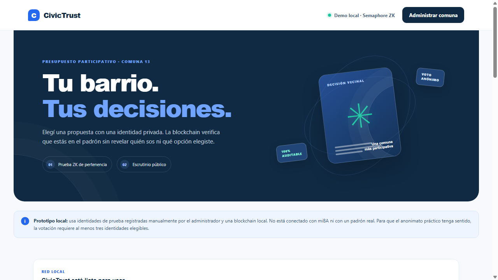
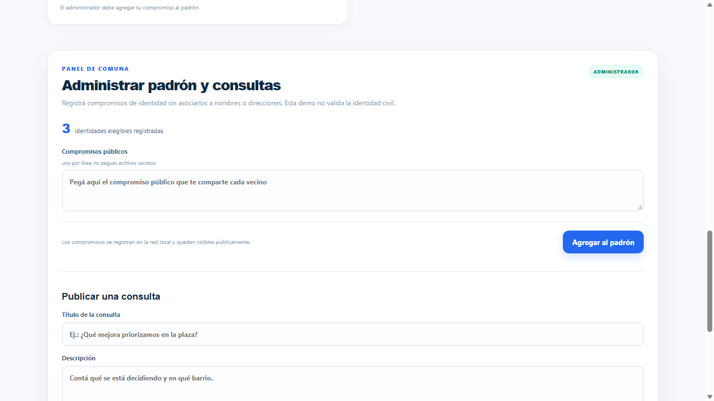
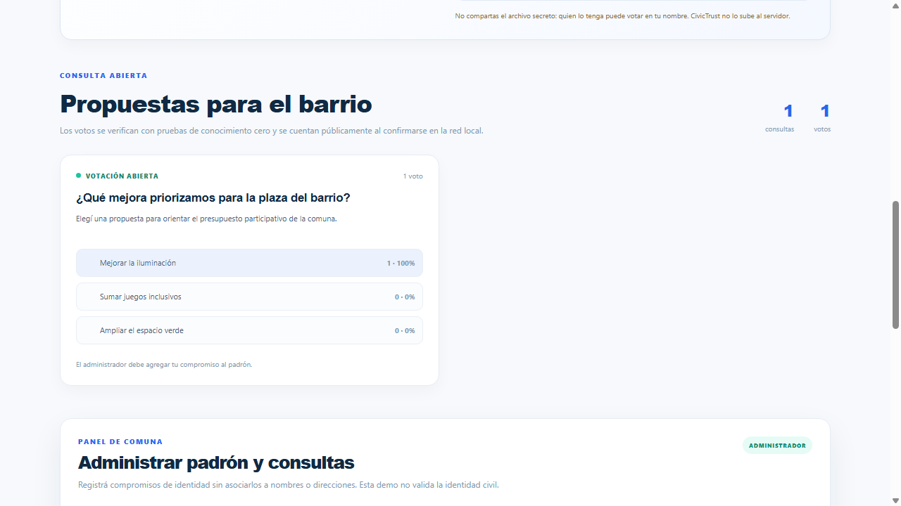
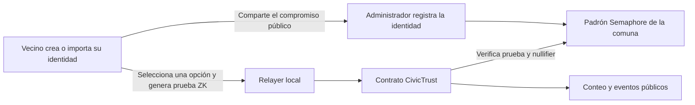

# CivicTrust

**CivicTrust** es un prototipo GovTech para presupuesto participativo comunal. Permite publicar consultas, habilitar identidades Semaphore y registrar votos con pruebas de conocimiento cero (ZK), con un escrutinio público verificable en una blockchain local.

La visión apunta a municipios y comunas; la interfaz de demostración representa la Comuna 13 con datos locales de prueba.

> **Estado:** MVP educativo local. No está conectado con miBA, DNI ni un padrón oficial, y no debe utilizarse para elecciones o decisiones públicas reales.

## Vista previa

| Inicio | Administración comunal | Escrutinio |
| --- | --- | --- |
|  |  |  |

[Ver el recorrido en video (MP4)](CIVICTRUST_VIDEO_MVP.mp4) · [Escuchar la narración (MP3)](CIVICTRUST_NARRACION.mp3) · [Subtítulos (SRT)](CIVICTRUST_VIDEO_MVP.srt)

## Qué demuestra el MVP

- El administrador conecta MetaMask a una red local y gestiona el padrón de compromisos y las consultas.
- Cada vecino puede crear o importar una identidad Semaphore en el navegador. El archivo secreto se descarga para que el vecino lo resguarde; el administrador recibe solo el compromiso público para registrar esa identidad.
- Antes de votar, el navegador genera una prueba ZK que acredita la pertenencia al grupo sin revelar qué compromiso la generó.
- Semaphore usa un *nullifier* por consulta para impedir que la misma identidad registrada vote dos veces en esa consulta.
- Un relayer local envía la prueba al contrato. El contrato verifica la prueba y actualiza el conteo; la billetera del vecino no paga gas en esta demo local.
- La consulta, las opciones y el conteo son públicos. El evento del contrato registra la opción y el *nullifier*, pero no la dirección del vecino como remitente.

### Flujo general



## Arquitectura y tecnologías

- **Contratos:** Solidity 0.8.28, Hardhat y Semaphore Protocol 4.x.
- **Aplicación web:** HTML, CSS y JavaScript; Vite compila la interfaz y ethers.js se comunica con los contratos.
- **Red de desarrollo:** nodo local Hardhat, chain ID `31337`.
- **Administración:** MetaMask con la cuenta local de prueba que Hardhat muestra al iniciar.
- **Votación:** la interfaz genera la prueba ZK; el servidor local actúa como relayer para enviar el voto al contrato.

```text
app/                         Interfaz web y estilos
contracts/CivicTrustVoting.sol Contrato de consultas y voto anónimo
scripts/                     Inicio, despliegue y servidor de la demo
docs/assets/                 Capturas para este README
GUIA_MVP_CIVICTRUST.md       Instrucciones para iniciar y probar la demo
GUIA_USUARIO_CIVICTRUST.md   Guía de uso para administrador y vecino
WHITE_PAPER_CIVICTRUST.md    Propuesta y visión del producto
SPEECH_HACKATHON_CIVICTRUST.md Guion de presentación
```

## Requisitos

- Node.js **20.19 o superior**, o **22.12 o superior**.
- npm.
- Chrome o Edge para abrir la aplicación.
- MetaMask solo para las tareas de administración. El vecino no necesita conectar una billetera para votar en la demo.
- Conexión a internet la primera vez que se genera una prueba ZK, para obtener los artefactos del circuito Semaphore.

## Iniciar la demo local

Desde la carpeta del proyecto:

```bash
npm ci
npm run dev
```

El comando compila los contratos, inicia Hardhat, despliega Semaphore y CivicTrust, crea una consulta de ejemplo y levanta la interfaz con el relayer local. Dejá abierta esa terminal mientras usás la aplicación y visitá:

**http://127.0.0.1:4173**

La demo usa estos parámetros de red:

| Parámetro | Valor |
| --- | --- |
| Red | CivicTrust Local (Hardhat) |
| RPC | `http://127.0.0.1:8545` |
| Chain ID | `31337` |
| Moneda | ETH de prueba |

Para administrar, importá en MetaMask la cuenta **#0 de Hardhat** que imprime la terminal, autorizá el acceso en la aplicación y cambiá a CivicTrust Local. No uses la clave privada de prueba en redes públicas ni le envíes fondos reales.

## Probar el flujo

1. En CivicTrust, abrí **Crear identidad privada** y descargá la copia secreta. Guardala en un lugar seguro.
2. Compartí con el administrador únicamente el **compromiso público** que muestra la aplicación. No compartas el archivo secreto.
3. Con la cuenta administradora conectada, pegá el compromiso en **Administrar padrón y consultas** y agregalo al padrón. Para esta demo se requieren al menos tres identidades elegibles.
4. Importá la copia secreta de una identidad que ya esté registrada.
5. Elegí una opción y pulsá **Votar anónimamente**. La interfaz genera la prueba ZK y el relayer local la envía al contrato.
6. Consultá el resultado público en la página. La prueba impide reutilizar la misma identidad en la misma consulta.

Al reiniciar `npm run dev` se crea una nueva blockchain local; los contratos, la consulta y los registros de la sesión anterior se pierden.

## Alcance y límites

El MVP demuestra votación anónima por identidad Semaphore y escrutinio verificable en una red local. **No verifica la identidad civil ni que cada persona tenga una única identidad.** En consecuencia, desde un mismo equipo se pueden crear varias identidades de prueba; la inscripción manual no resuelve el problema Sybil de una implementación real.

También quedan fuera de esta versión:

- Integración con miBA, DNI, Mi Argentina u otro proveedor oficial de identidad.
- Despliegue en una Layer 2 o red pública, servicio de relayer de producción, ERC-4337 y *paymaster* institucional.
- Protección de metadatos o una auditoría independiente de contratos y circuitos.
- Ocultamiento de la opción elegida: la opción y el resultado son públicos en la blockchain.
- Custodia de presupuesto, pagos por hitos de obra, oráculos y gobernanza descentralizada.

El anonimato práctico requiere un grupo con suficientes integrantes. El contrato de esta demo exige como mínimo tres identidades registradas, pero ese requisito no equivale a verificar que correspondan a tres personas reales.

## Comandos disponibles

| Comando | Descripción |
| --- | --- |
| `npm run dev` | Compila, inicia la red local, despliega los contratos, crea la consulta de ejemplo y levanta la aplicación. |
| `npm run compile` | Compila los contratos Solidity. |
| `npm run node` | Inicia un nodo Hardhat local. |
| `npm run deploy:local` | Compila y despliega en el nodo configurado en `localhost`. |
| `npm run serve` | Inicia la interfaz y el relayer local; requiere que el nodo y el despliegue ya estén disponibles. |

## Documentación

- [Guía de inicio y configuración](GUIA_MVP_CIVICTRUST.md)
- [Guía de usuario](GUIA_USUARIO_CIVICTRUST.md)
- [Resumen del proyecto](RESUMEN_CIVICTRUST.md)
- [Whitepaper de entrega (PDF)](CIVICTRUST_WHITEPAPER_FERRARO.pdf)
- [Fuente del whitepaper (Markdown)](WHITE_PAPER_CIVICTRUST.md)
- [Speech para hackathon](SPEECH_HACKATHON_CIVICTRUST.md)

## Licencia

La licencia del repositorio completo está pendiente de definición. El identificador SPDX del contrato Solidity no establece por sí solo la licencia de todos los archivos del proyecto.
